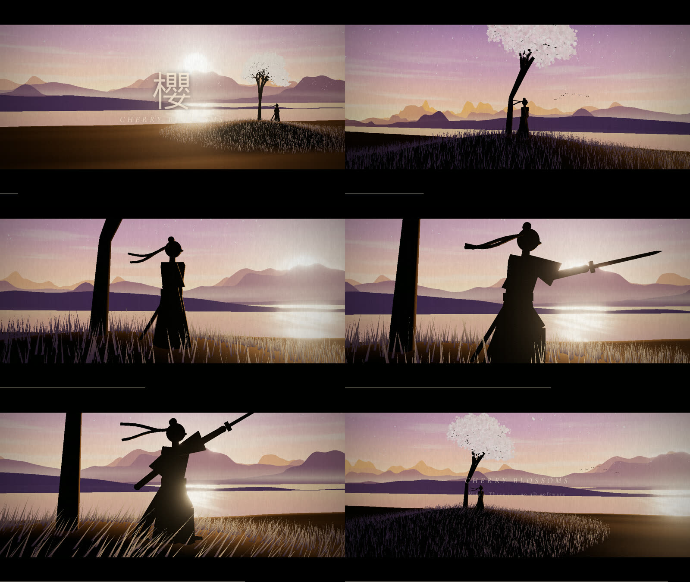

# Cherry Blossoms · 樱

A 57-second micro-film, all code: Vite + Three.js, no 3D software, no image
assets. Built in reply to the @cfenghub post about Opus 5.5's "Cherry Blossoms"
(sunset melting into gold, ink-wash mountains, a lone swordsman under falling
petals, paper-cut / shadow-puppet restraint).

- **Watch it live:** the `pages` job publishes `dist/` to GitHub Pages on every push.
- **Rendered MP4:** `Run workflow` on the `render` action; 1710 frames are captured
  headless in parallel chunks, stitched with ffmpeg, and attached to a release
  tagged `run-<number>` together with a contact sheet.



## What is in the frame

| Part | How |
|---|---|
| Sky | one gradient function (`skyColor`) shared by the sky sphere and the lake, plus a sun disc and fbm cloud streaks |
| Mountains | six paper-cut ridges from 1-D value noise; `MeshBasicMaterial` + `scene.fog` gives the aerial perspective for free |
| Lake | mirrors `skyColor`, with the sun's gold streak computed from the azimuth difference to the sun |
| Tree | recursive branches merged into one mesh; 14 billboard blossoms per twig tip, backlit toward the sun |
| Petals | 3000 instances, position = f(seed, time) in the vertex shader; the sword swing is a vortex with a rise-then-decay envelope |
| Swordsman | shadow-puppet rig of extruded `Shape`s, joints rotate in the profile plane, 11 poses keyframed over the film; the sun behind him lights only the extruded edges |
| Grade | bloom for the sun, then paper fibre, grain, vignette and the fades |

Everything is a pure function of time, so a frame rendered on one machine is
identical on another, which is what lets the render be split across jobs.

## Run it

```
npm install
npm run dev          # http://127.0.0.1:5178  (SPACE pause, R replay)
npm run build
node scripts/render.mjs --start 0 --end 1709 --out frames
ffmpeg -framerate 30 -i frames/f%05d.png -c:v libx264 -pix_fmt yuv420p -crf 17 cherry_blossoms.mp4
```

Locally, point `PUPPETEER_EXECUTABLE_PATH` at an installed Chrome and install
with `PUPPETEER_SKIP_DOWNLOAD=1` if you do not want puppeteer's own copy.
